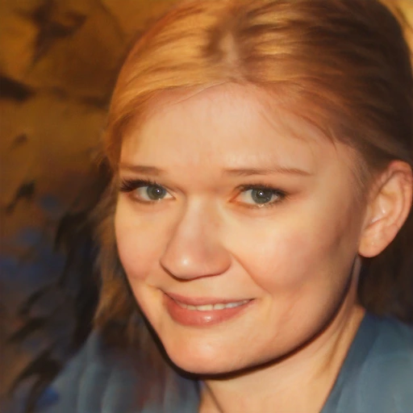
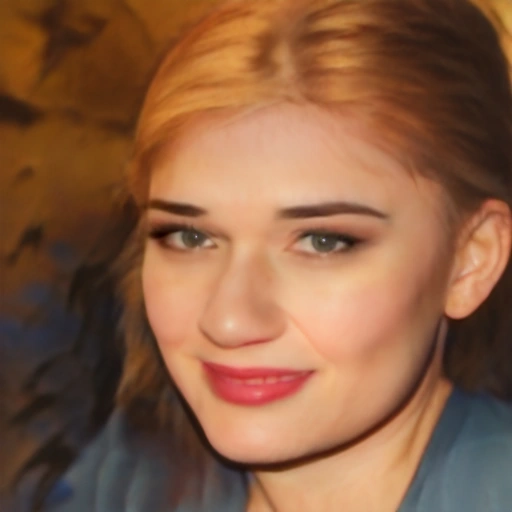
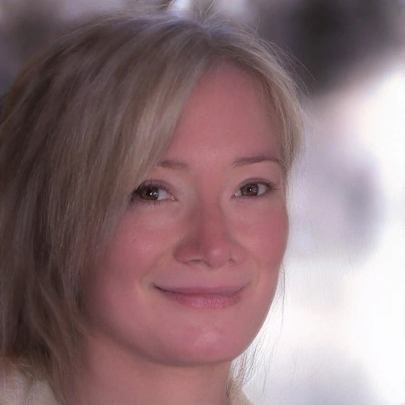
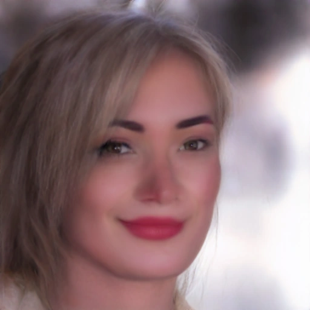
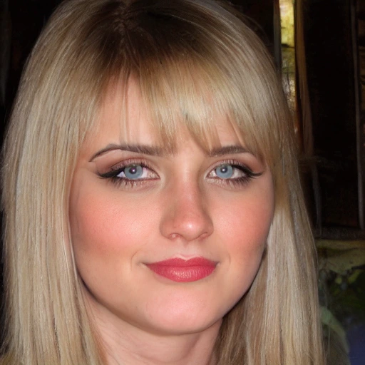
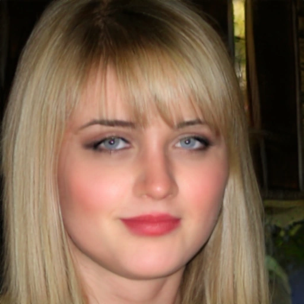

# TinyBeauty — Microtextura em 512 × 512

Galeria alternativa para celular, sem depender da publicação do GitHub Pages.

Compare o teacher corrigido com a saída da U-Net de 256 pixels ampliada,
a aplicação do residual sobre a imagem 512 e o refinador de alta frequência.
O TinyBeauty sem Albumentations continua preservado como MVP.

**Nota metodológica:** energia espectral próxima da do teacher não significa textura correta.
A variante de microcontraste pode produzir detalhes diferentes dos desejados.

[Abrir a galeria interativa, quando disponível](https://kosmosapien.github.io/APS-TinyBeauty-Gallery/tinybeauty-detail512-20261104/)

### Comparação de modelos (136 identidades de validação)

| Versão | Erro highpass (↓) | Energia highpass relativa ao teacher |
|:--|--:|--:|
| U-Net 256 ampliada, RGB inteiro | 0,02284 | 55,4% |
| Residual da U-Net sobre fotografia original 512 | 0,02688 | 88,2% |
| Refinador 512, perda pixelwise | 0,02213 | 45,8% |
| Refinador 512, perda de altas frequências | **0,02202** | 45,5% |
| Refinador 512, perda de microcontraste | 0,02792 | **98,2%** |

### Fotografias de validação

Clique para expandir cada identidade. Todas as versões têm a mesma fonte e o mesmo teacher.

<strong>Identidade 01</strong> — SFHQ_pt3_00001690

<strong>Original / Teacher:</strong>

<strong>U-Net RGB ampliada / Transformação residual em 512:</strong>

<strong>Refinador pixel / Frequência / Microcontraste — 2500 passos:</strong>

<strong>Identidade 02</strong> — SFHQ_pt3_00002799

<strong>Original / Teacher:</strong>

<strong>U-Net RGB ampliada / Transformação residual em 512:</strong>

<strong>Refinador pixel / Frequência / Microcontraste — 2500 passos:</strong>

<strong>Identidade 03</strong> — SFHQ_pt3_00005043

<strong>Original / Teacher:</strong>

<strong>U-Net RGB ampliada / Transformação residual em 512:</strong>

<strong>Refinador pixel / Frequência / Microcontraste — 2500 passos:</strong>

<strong>Identidade 04</strong> — SFHQ_pt3_00005983

<strong>Original / Teacher:</strong>

<strong>U-Net RGB ampliada / Transformação residual em 512:</strong>

<strong>Refinador pixel / Frequência / Microcontraste — 2500 passos:</strong>

<strong>Identidade 05</strong> — SFHQ_pt3_00006549

<strong>Original / Teacher:</strong>

<strong>U-Net RGB ampliada / Transformação residual em 512:</strong>

<strong>Refinador pixel / Frequência / Microcontraste — 2500 passos:</strong>

<strong>Identidade 06</strong> — SFHQ_pt3_00006969

<strong>Original / Teacher:</strong>

<strong>U-Net RGB ampliada / Transformação residual em 512:</strong>

<strong>Refinador pixel / Frequência / Microcontraste — 2500 passos:</strong>

<strong>Identidade 07</strong> — SFHQ_pt3_00007250

<strong>Original / Teacher:</strong>

<strong>U-Net RGB ampliada / Transformação residual em 512:</strong>

<strong>Refinador pixel / Frequência / Microcontraste — 2500 passos:</strong>

<strong>Identidade 08</strong> — SFHQ_pt3_00007369

<strong>Original / Teacher:</strong>

<strong>U-Net RGB ampliada / Transformação residual em 512:</strong>

<strong>Refinador pixel / Frequência / Microcontraste — 2500 passos:</strong>

<strong>Identidade 09</strong> — SFHQ_pt3_00007455

<strong>Original / Teacher:</strong>

<strong>U-Net RGB ampliada / Transformação residual em 512:</strong>

<strong>Refinador pixel / Frequência / Microcontraste — 2500 passos:</strong>

<strong>Identidade 10</strong> — SFHQ_pt3_00008011

<strong>Original / Teacher:</strong>

<strong>U-Net RGB ampliada / Transformação residual em 512:</strong>

<strong>Refinador pixel / Frequência / Microcontraste — 2500 passos:</strong>

## Arquivos e reprodução

Dataset de validação: 136 identidades V4 Social corrigido; treino 1000 pares.
Scripts e pesos estão em NeuralFilters e C:\Datasets\APS-Makeup\TinyBeautyExperiments\Global512Detail_20261104.
Nenhuma versão foi promovida ao MVP; resultados para avaliação e pesquisa.
